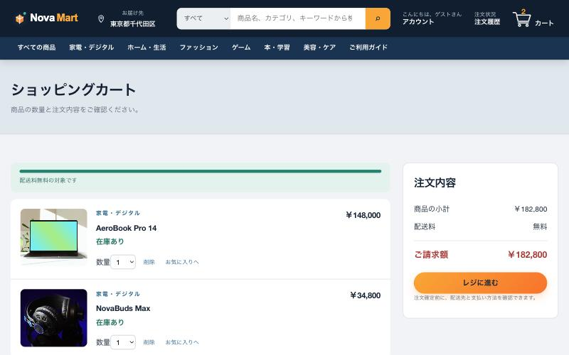
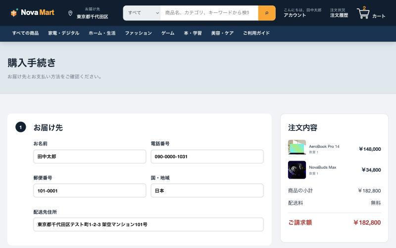
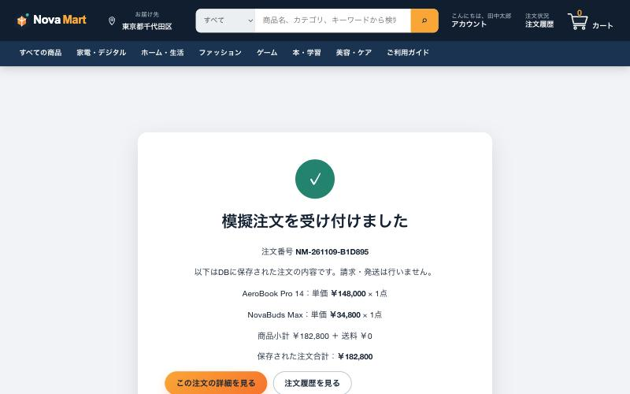
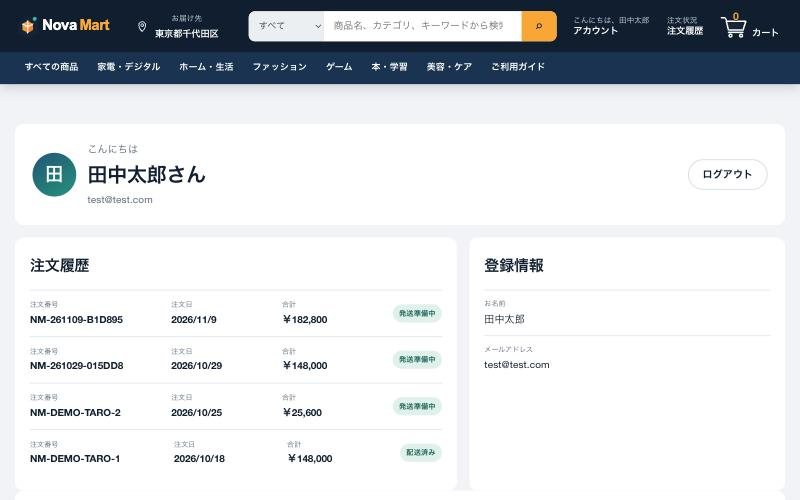

# NovaMart — PHP + MySQL で作ったECサイト

架空のオンラインストア「NovaMart」です。商品検索からカート、会員ログイン、注文、注文履歴までの一連の流れを、PHP と MySQL で実装しました。


## 主な機能

| 分類 | 機能 |
|---|---|
| 商品 | 商品一覧（約100点）、キーワード検索、カテゴリ・価格・評価での絞り込み、並び替え、商品詳細 |
| カート | カートへの追加、数量変更・削除、送料の自動計算、お気に入り |
| 会員 | 新規会員登録、ログイン／ログアウト、配送先住所の登録・変更 |
| 注文 | 購入手続き、注文確定（DBへ保存）、注文完了画面、注文履歴、注文詳細 |
| レビュー | 商品レビューの投稿・一覧表示・自分のレビューの削除 |
| その他 | ご利用ガイド、配送・支払い・返品・プライバシー・利用規約ページ、レスポンシブ対応 |

## 画面

| 商品一覧 | 商品詳細 |
|---|---|
|  |  |

| カート | 購入手続き |
|---|---|
|  |  |

| 注文完了 | 注文履歴（マイページ） |
|---|---|
|  |  |

## 使用技術

- **フロントエンド：** HTML / CSS / JavaScript（フレームワークなし）
- **バックエンド：** PHP 8（PDO）
- **データベース：** MySQL
- **開発環境：** MAMP（macOS）

画面は HTML と JavaScript で描画し、ログインや注文などのデータ処理は PHP の API（`api/` フォルダ）が JSON で返す構成です。

```
├── *.html            各画面
├── css/              スタイル
├── js/               画面ごとの処理（API呼び出し・描画）
├── api/              PHP の API（auth / products / orders / reviews / profile）
├── config/           DB接続・セッション設定
├── sql/              テーブル定義と初期データ
└── tools/setup.php   DB作成スクリプト
```

### データベース

`users`（会員）、`products`（商品）、`orders` / `order_items`（注文と注文明細）、`reviews`（レビュー）、`customer_profiles`（配送先）の6テーブルです。注文確定時は在庫と価格をDBから取得し、トランザクション内で注文と明細を保存しています。

## 安全に作るために気をつけたこと

- **SQLインジェクション対策：** すべてのSQLをプリペアドステートメントで実行
- **パスワード保護：** `password_hash()` でハッシュ化して保存し、平文では保存しない
- **XSS対策：** レビューなどユーザーが入力した文字は、画面に出す前にエスケープ
- **CSRF対策：** 登録・注文・レビュー投稿などの更新処理でトークンを照合
- **アクセス制御：** 注文詳細は、ログイン中の本人の注文だけを表示
- **価格の改ざん対策：** 注文金額はブラウザから送られた値ではなく、サーバー側でDBの価格から計算
- **セッション管理：** ログイン時にセッションIDを再発行し、Cookie に HttpOnly / SameSite を設定

## ローカルでの動かし方

1. MAMP を起動し、このフォルダを MAMP のドキュメントルート（`htdocs`）配下に置く
2. ターミナルで DB を作成する
   ```bash
   php tools/setup.php
   ```
3. ブラウザで `http://localhost:8888/<配置したフォルダ>/index.html` を開く

動作確認用アカウント（架空）：`test@test.com` / `1234`

> 本サイトはローカル環境での動作確認を前提としています。`localhost` 以外からのアクセスは拒否する設定にしています。注文は模擬注文で、請求・発送は行いません。商品・会員・注文データはすべて架空のものです。
